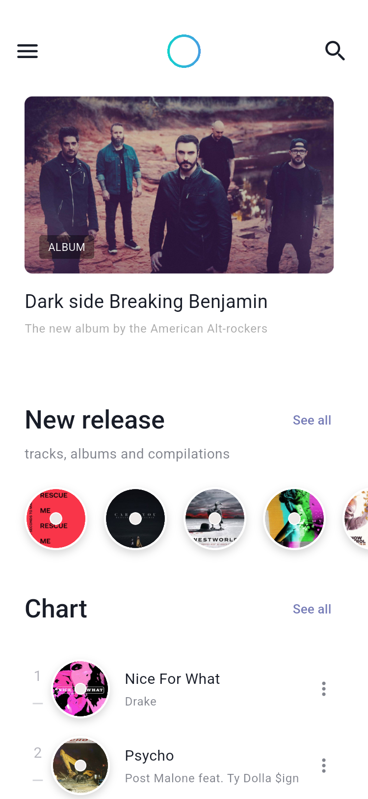
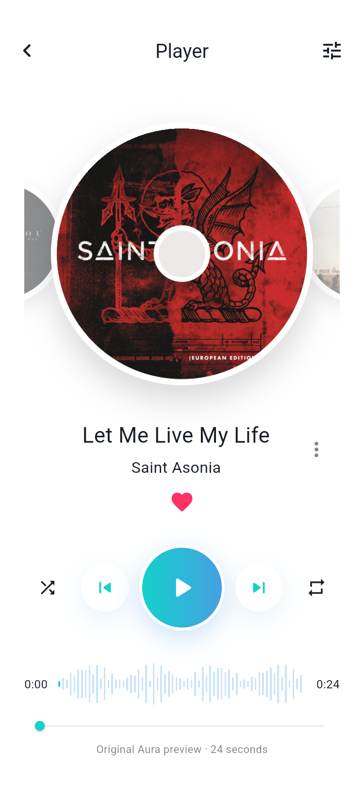
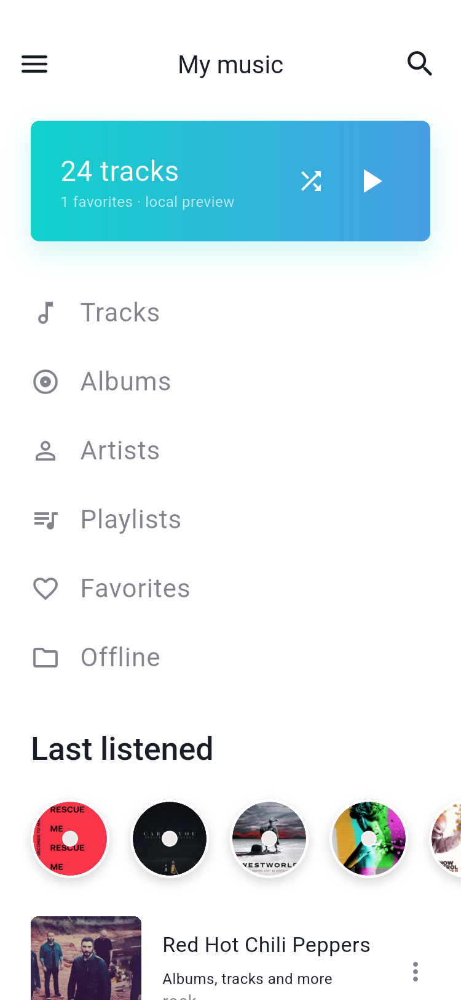
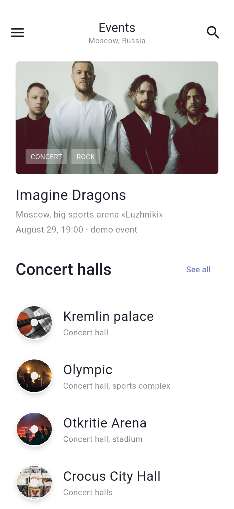
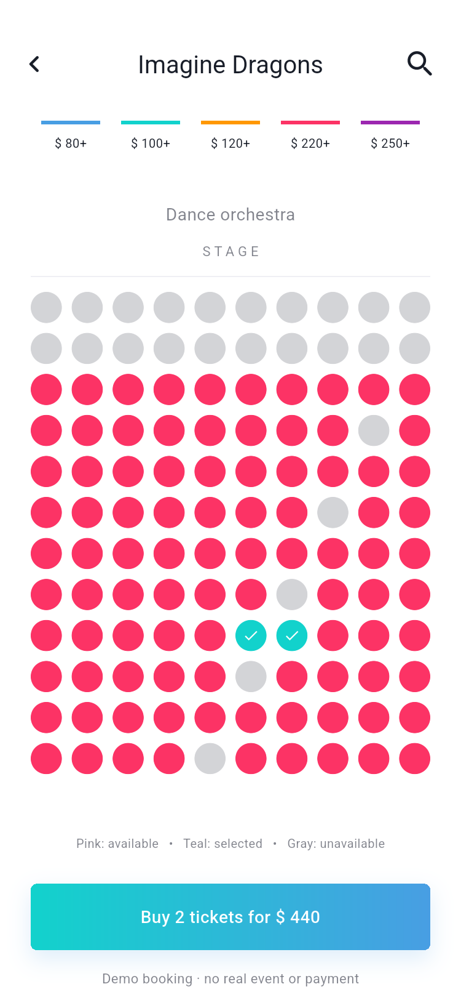
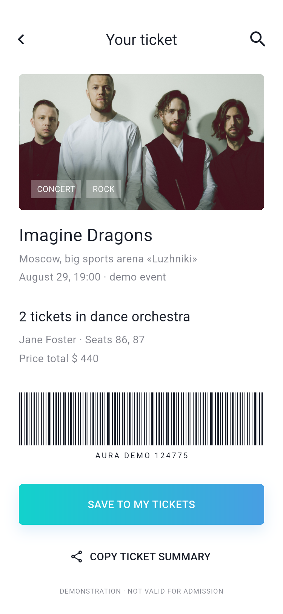

# Aura Music

基于 Pixso **Music servise_light** 与 **Music servis_dark** 两份参考稿的 Flutter 音乐应用 UI 实现。包含 45 个参考画板对应的页面与状态、原创本地音频试听，以及可操作的演出选座与模拟购票流程。


已按新提供的暗色稿完成同一套应用的双主题适配。新安装默认暗色，升级保留已保存的选择；在 Settings → Dark theme 切换。详见 [暗色主题说明与主要界面](docs/DARK_THEME.md) 和 [全部暗色截图](docs/SCREENSHOTS_DARK.md)。


## 快速运行

已生成可安装的 [Android 预览安装包](dist/aura-music-demo.apk)（通用 Release APK，约 67.4 MiB）。安装包使用开发签名，供本地演示。

开发环境：Flutter 3.47.7、Dart 3.13.5。Android 模拟器使用 Android 15 / API 35。

```powershell
flutter pub get
flutter run
```

也可以指定设备：

```powershell
flutter run -d emulator-5554
flutter run -d chrome
```

默认进入首页。左上角菜单可进入音乐库、电台、演出、推荐、个人资料与设置；点击顶部 Aura 圆环进入音乐助手。菜单中的 **Discover Aura** 可以重新体验五页引导、创建本地资料和音乐偏好流程。

## 主要界面

以下图片来自实际运行的 Flutter 应用。全部页面截图与 Pixso 参考图的对应关系见 [界面截图索引](docs/SCREENSHOTS.md)。

| 首页 | 播放器 | 音乐库 |
| --- | --- | --- |
|  |  |  |

| 演出 | 选座 | 票据 |
| --- | --- | --- |
|  |  |  |

## 已实现的交互

- 音乐浏览：首页推荐、单曲/专辑切换、排行榜、专辑详情、艺人、曲风与歌单。
- 播放：实际播放本地 24 秒原创试听音频，支持暂停、进度拖动、上一首/下一首、随机与循环。迷你播放器与详情页共享状态。
- 个人音乐库：歌曲、专辑、艺人、歌单、收藏和离线试听入口；收藏可跨启动保存。
- 搜索：按歌名和歌手筛选，包含搜索历史、清空记录和无结果状态。
- 个人资料：本地资料表单验证、编辑姓名/邮箱、偏好与深色主题保存。
- 电台：能量、心情、收藏/热门等条件影响本地播放队列。
- 演出：演出详情 → 场馆分区 → 选择可售座位 → 校验持票人 → 模拟确认 → 保存票据、复制摘要。票据保存确认时的座位快照。
- 引导、音乐偏好、Aura 本地歌曲查找、歌词与跟唱展示、识曲演示、均衡器预设界面。

## 项目结构

```text
lib/
├── main.dart                    # 初始化与启动
├── app.dart                     # 应用主题、响应式外壳、路由分发
├── core/
│   ├── routes.dart               # 45 个页面/状态的类型安全路由
│   └── theme.dart                # 亮/暗语义颜色、文字、表单和控件样式
├── data/
│   └── catalog.dart              # 歌曲/歌单模型、本地目录与搜索
├── services/
│   ├── audio_engine.dart         # 音频接口与 audioplayers 实现
│   └── preferences.dart          # 持久化接口与本地存储实现
├── state/
│   └── app_controller.dart       # 播放、收藏、资料、偏好和票据状态
└── ui/
    ├── widgets/common.dart       # 唱片、按钮、列表、网格、页面外壳等
    └── screens/
        ├── discover.dart         # 首页、目录、音乐库、曲风
        ├── listening.dart        # 播放器、电台、歌词、识曲、均衡器
        ├── account.dart          # 菜单、引导、偏好、账户、Aura
        ├── events.dart           # 演出、场馆、选座、模拟支付、票据
        └── search_settings.dart  # 搜索与设置
assets/
├── images/                      # 从 Pixso 节点导出的 37 个图片素材
└── audio/aura-preview.wav        # 原创 24 秒离线试听
test/                            # 状态、业务和全部页面布局测试
integration_test/                # Android 真实音频、交互、截图测试
test_driver/                     # 将模拟器截图保存到本地
docs/
├── ARCHITECTURE.md               # 架构、状态流、扩展点、实现边界
├── SCREENSHOTS.md                # 亮色截图与画板对应表
├── DARK_THEME.md                 # 暗色主题设计、实现与主要界面
├── SCREENSHOTS_DARK.md           # 全部暗色截图与参考对应表
├── design-map.json               # Pixso 节点、尺寸、素材来源记录
├── design-map-dark.json          # 暗色画板、尺寸与主题颜色记录
├── design-reference/             # 45 张 Pixso 原始参考图
├── design-reference-dark/        # 45 张 Pixso 暗色参考图
└── screenshots/                  # 实际运行截图
```

详细设计见 [项目架构说明](docs/ARCHITECTURE.md)。

## 验证与截图

```powershell
flutter analyze
flutter test
flutter drive -d emulator-5554 --driver test_driver/integration_test.dart --target integration_test/app_test.dart
```

最后一个命令会分别生成亮色与暗色的 45 个页面截图，并各保存 4 个补充交互状态，共 98 张编号截图。亮色位于 `docs/screenshots/`，暗色位于 `docs/screenshots/dark/`。运行时使用隔离的内存数据，不覆盖平时使用的本地资料。

验证环境、测试结果和平台范围见 [验证记录](docs/VALIDATION.md)。Widget 测试使用小图替身检查布局，Android 集成测试使用全部真实设计素材。

生成 Android 预览安装包：

```powershell
flutter build apk --release
```

模板中的 Android release 当前使用开发签名，适合本地预览。正式发布需配置自己的签名与应用标识。

## 实现边界

本项目交付的是可运行的 UI 与本地交互演示。参考稿中的歌曲/歌手/演出信息是展示数据；所有歌曲条目播放同一段原创 Aura 音频，不包含原曲音源。歌词为试听界面的原创展示文本，跟唱高亮按试听进度演示。

账户是本地资料，不连接在线登录；Aura 使用本地目录检索；识曲流程不录音、不调用识曲服务；均衡器仅展示预设与滑杆，不修改声音。订阅和支付均为演示，不收费；票据不具备入场效力。通知、连接策略和高音质选项目前不连接对应的后台能力。

UI 沿用原稿的英文内容、留白、青蓝渐变、圆形唱片与照片素材。字体采用系统无衬线字体代替原稿 SF UI Display；修正了原稿部分文字重叠，并为真实数据量调整了音乐库计数。设计素材的使用权仍以原设计文件的许可为准。
