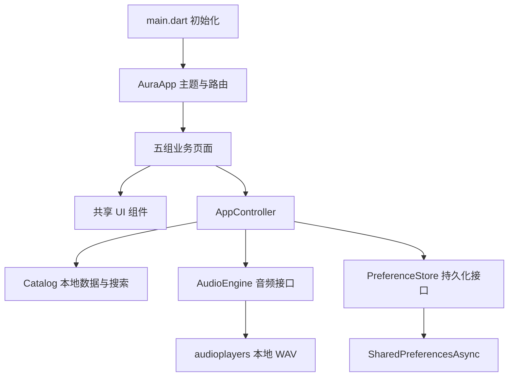
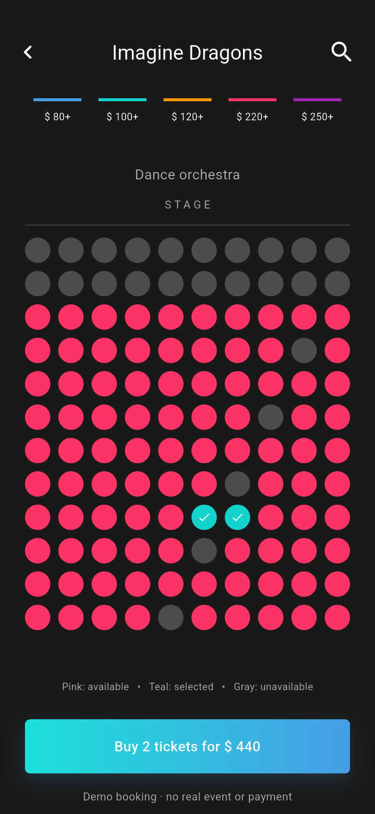

# Aura Music 项目架构说明

## 设计来源与目标

- 设计文件：Pixso `Music servise_light` 与 `Music servis_dark`。
- 页面：`xd page`；亮色页 `0:1`，暗色页 `0:5155`，各 45 个参考画板。
- 参考基准宽度 375，长页面用滚动容器实现。应用最大内容宽度 600，在桌面/Web 上居中。
- 原始画板完整导出到 `design-reference/` 与 `design-reference-dark/`；37 个独立封面、照片、背景等节点导出到 `assets/images/`，明暗主题共用。应用通过原生 Flutter 组件实现布局和交互，没有将整张设计图用作页面。
- 节点与素材记录见 [亮色设计记录](design-map.json) 和 [暗色设计记录](design-map-dark.json)。

## 架构选择

采用轻量的分层结构：页面组件 → AppController → 数据/平台服务。全局状态使用 Flutter 自带的 `ChangeNotifier` 与 `InheritedNotifier`，避免为本地 UI 演示增加额外状态管理和路由框架。只有音频和轻量存储两个运行时第三方依赖。

### 各层职责

| 层 | 职责 | 约束 |
| --- | --- | --- |
| `core` | 统一主题与 AppRoute 路由定义 | 页面不使用散落的字符串路由 |
| `data` | Track/MusicCollection、静态音乐目录、搜索 | 不依赖 Widget 或平台插件 |
| `services` | 音频和存储接口及实现 | 可通过构造函数注入测试替身 |
| `state` | 跨页业务状态、播放指令、收藏与持久化、票据快照 | 不保存表单密码或银行卡信息 |
| `ui/widgets` | 可复用页面外壳、唱片、歌曲行、按钮、图片与网格 | 颜色与风格集中到主题 |
| `ui/screens` | 按业务组织的 45 个页面与展示状态 | 表单、输入框等短期状态留在页面内 |

五组页面文件分别维护音乐发现、听歌、账户、演出、搜索/设置；五页引导、识曲的三个状态、两种歌词展示等复用同一页面组件，通过枚举参数区分，减少重复布局。

## 主要界面与流转

亮色界面及对应关系见 [亮色截图索引](SCREENSHOTS.md)。

### 浏览与播放

`Home → Album / Artist / Chart / New release → Player → Lyrics / Sing along / Equalizer`

点击歌曲交给 `AppController.play(track)`。`AudioEngine` 转发真实的播放器状态和时间事件；播放器和迷你播放器订阅同一个控制器，显示一致的当前歌曲、播放状态与进度。`StreamSubscription` 在控制器销毁时取消，音频实例同步释放。

播放的是 24 秒原创本地 WAV。歌名、封面和目录中的原曲时长仅来自参考展示数据，播放器明确标出试听音频长度。随机与上一首/下一首改变元数据和播放队列；循环通过播放器的 ReleaseMode 实现。

播放进度每 250ms 读取一次。应用外壳只在主题变化时重新构建，并缓存明暗两套 ThemeData，避免播放进度更新时重建整个 MaterialApp。

### 收藏、偏好与个人资料

收藏以歌曲 ID 集合保存。页面调用控制器完成更新，并持久化到 `SharedPreferencesAsync`。启动时先 `load()` 再显示界面，避免资料和主题闪烁。偏好选择影响推荐结果展示和电台队列。

本地资料表单会验证姓名、邮箱和密码长度；密码仅用于表单交互，不写入磁盘。本地持久化适用于演示偏好，不承担真实身份认证或敏感数据存储。

### 演出与票据

`Events → Event detail → Venue → Seats → Payment → Ticket`

灰色座位不可选，粉色可售，青色为已选。总价 = 选中数量 × 220。没有座位时不能进入确认流程；提交前检查持票人姓名。

确认时复制并排序已选座位到 `bookedSeats`，保存 `ticketHolder`，形成独立的已确认记录。之后改变选座不影响现有票据。票据可保存到本地，并可将摘要复制到剪贴板。示例条码由 CustomPainter 绘制，不对应真实验票系统。

### 搜索与辅助流程

搜索对歌名和艺人执行不区分大小写的本地匹配，处理空输入、结果列表与无结果状态。搜索历史可保存和清空。Aura 复用目录搜索；识曲保留开始、收听、结果三种 UI 状态，以明确标注的本地演示替代录音。

## 持久化字段

`aura` 键保存 JSON：`name`、`email`、`favorites`、`genres`、`settings`、`history`、`ticketPurchased`、`ticketSaved`、`seats`、`bookedSeats`、`ticketHolder`。

播放进度、当前队列、搜索输入、未提交表单、电台滑杆与均衡器参数属于当前会话。模拟支付使用只读样例卡信息，不收集或保存真实卡号。

## 视觉实现

| 项目 | 亮色 | 暗色 |
| --- | --- | --- |
| 页面背景 | `#FFFFFF` | `#191919` |
| 次级表面 | `#F6F6FA` | `#222222` |
| 主文字 | `#181D28` | `#FFFFFF` |
| 次文字 | `#82848D` | `#AAAAAA` |
| 主渐变 | `#12D2CC → #489EE3` | `#1CE0DA → #479DE4` |
| 唱片边缘 / 中心 | `#FFFFFF / #EEE9E9` | `#404040 / #191919` |

`AuraPalette extends ThemeExtension` 集中管理语义颜色，页面通过 `context.aura` 读取。主题还覆盖表单、弹窗、开关、分隔线和系统状态栏。音波、场馆和条码的 CustomPainter 接收主题颜色并在颜色变化时重新绘制。

新安装默认暗色；已保存的主题选择优先。Settings 中切换主题会保留路由、当前歌曲和业务状态。详细设计来源见 [暗色主题说明](DARK_THEME.md)。

两套主题共用粉色收藏/可售座位 `#FC3365`、照片和封面。左右内容间距 25，网格间距 15，分区上间距 30；字体为系统无衬线。唱片由图片、圆形裁剪、主题中心孔和边缘组合。

列表与网格根据容器宽度调整高度，标题限制行数防止溢出。大部分长页面使用滚动容器；所有图片打包在本地，运行不依赖图片 CDN。

## 验证方式

1. `flutter analyze`：静态分析。
2. `flutter test`：目录查询、持久化、票据快照、播放控制、搜索 UI、主题切换与颜色，以及 45 个页面 × 375/600 宽度 × 明暗两套主题的 180 次布局渲染。
3. Android 集成测试：在真实 Flutter 引擎中分别遍历两套主题，验证本地音频启动/进度/暂停、搜索正常与空状态、选座付款到生成票据、保存票据和主题切换，共生成 98 张编号截图。
4. 截图人工检查：对照 Pixso 参考图检查封面、字体层级、留白、按钮和滚动页面。

自动化截图使用内存存储实例，避免污染用户资料。实际应用使用平台本地存储实例。完整图片索引见 [亮色截图](SCREENSHOTS.md) 和 [暗色截图](SCREENSHOTS_DARK.md)。

Widget 布局测试使用小型图片替身，隔离宿主机图片编解码。真实图片、裁切和视觉表现通过 Android 集成截图检查；相关平台限制见 [验证记录](VALIDATION.md)。

## 后续服务接入位置

若继续开发线上产品，可在现有服务接口后接入真实目录、登录、流媒体播放、推荐、识曲和票务接口。真实音源需要授权；支付需要独立订单和服务器验证；订阅需要平台内购校验；均衡器需接入实际音频处理能力。目前这些都没有后台连接，不能将本地演示状态作为交易或身份凭证。

精简策略：复用页面状态与公共组件；保持两个运行时依赖；去除默认计数器示例；设计稿、截图和测试不进入应用的 assets；不为 UI 演示加入空的网络层、数据库或生成代码框架。
