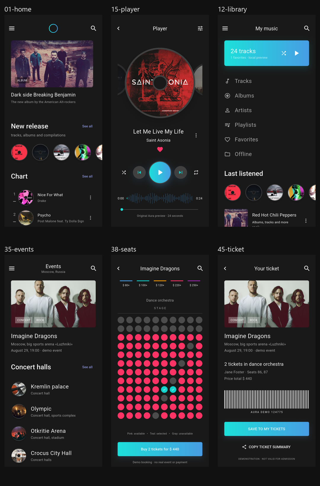
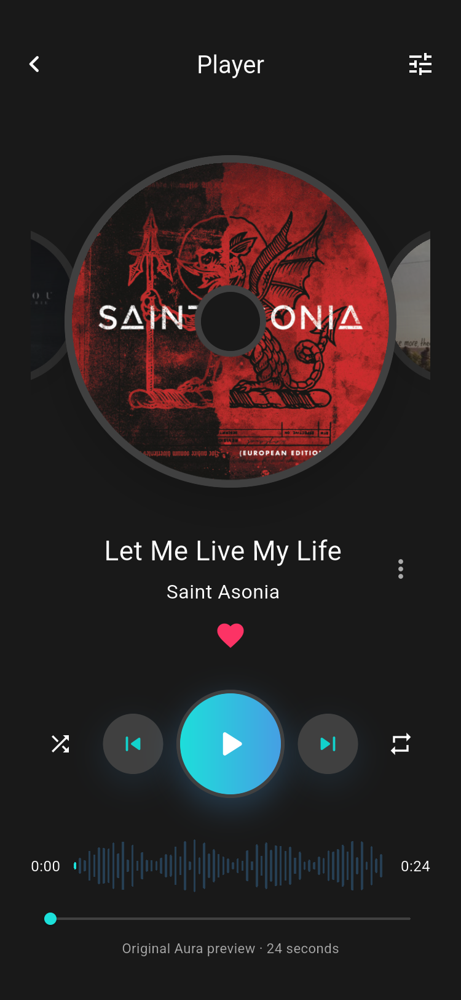
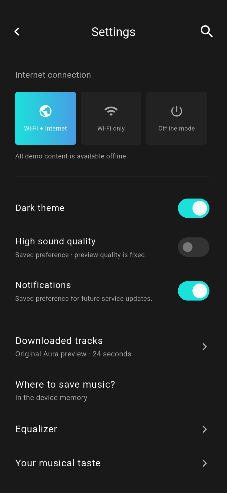
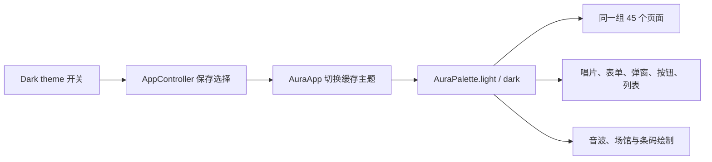

# Aura Music 暗色主题

暗色主题依据 Pixso **Music servis_dark / xd page** 的 45 个画板补充实现。它与前一份 **Music servise_light** 共用同一个 Flutter 项目、页面和业务状态。

## 使用方式

新安装默认使用暗色主题。打开菜单 → Settings → **Dark theme** 可实时切换亮色/暗色；收藏、播放队列、票据和当前页面会保留。升级安装时尊重此前已经保存的主题选择。

更新后的 [Android 预览安装包](../dist/aura-music-demo.apk) 同时包含两种主题。

## 主要界面

| 首页 | 播放器 | 音乐库 |
| --- | --- | --- |
|  |  |  |

| 搜索 | 设置 | 票据 |
| --- | --- | --- |
|  |  |  |

全部暗色截图与原始画板的对应关系见 [暗色界面截图索引](SCREENSHOTS_DARK.md)。

## 颜色与组件

| 用途 | 暗色值 | 来源/处理 |
| --- | --- | --- |
| 页面背景 | `#191919` | Home、Player、My music 等画板背景 |
| 输入框、消息与次级表面 | `#222222` | Login 输入框节点 |
| 圆形控制按钮 | `#404040` | 播放器深灰控制面 |
| 主文字与图标 | `#FFFFFF` | Player 标题与歌曲名称 |
| 次级文字 | `#AAAAAA` | 统一为可读的中性灰 |
| 唱片边缘 | `#404040` | Player 的 Subtraction 49 节点 |
| 唱片中心 | `#191919` | Player 的 Ellipse 283 节点 |
| 主按钮渐变 | `#1CE0DA → #479DE4` | Login 按钮填充 |

保留封面和照片本身的颜色。图片上的白色文字、渐变按钮的白色文字、粉色收藏和座位状态沿用原稿语义。

## 架构

`lib/core/theme.dart` 中的 `AuraPalette` 是一个 `ThemeExtension`，集中管理背景、表面、文字、边界、唱片中心/边缘、链接和渐变。

页面通过 `context.aura` 读取语义颜色。自绘组件由上层传入主题颜色，切换后重新绘制。这样避免分别维护两套页面，也能保证票据条码、分隔线和弹窗不会残留不适合暗色背景的颜色。

主题变化只更新应用外壳；播放进度仍由共享控制器管理，切换主题不会重置播放或路由。选择通过现有 `SharedPreferencesAsync` 机制保存。

## 验证

- Widget 测试检查两种主题在 375/600 宽度下的全部页面布局，共 180 个页面渲染检查。
- 新增测试检查暗色默认值、Pixso 背景/输入框/唱片边缘颜色、切换后的页面与播放状态，以及亮色选择的持久化。
- Android 集成用例分别遍历亮色与暗色的全部 45 个页面，并验证真实试听、搜索、选座、模拟购票及主题切换。
- 两套运行截图各有 45 张页面首屏和 4 张补充状态图；原始暗色画板保存在 `design-reference-dark/`。

原始节点与主题数据见 [design-map-dark.json](design-map-dark.json)。账户、识曲、支付和均衡器仍保持项目原有的演示边界，详见 [架构说明](ARCHITECTURE.md)。
