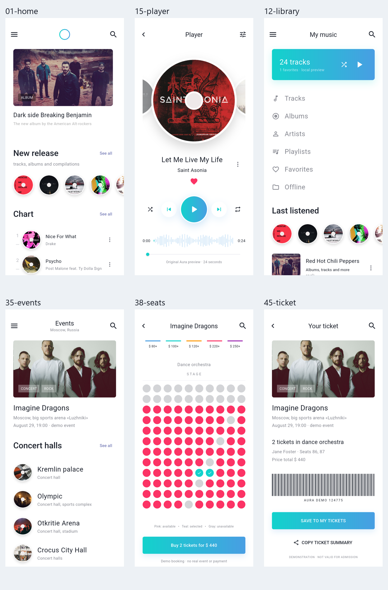
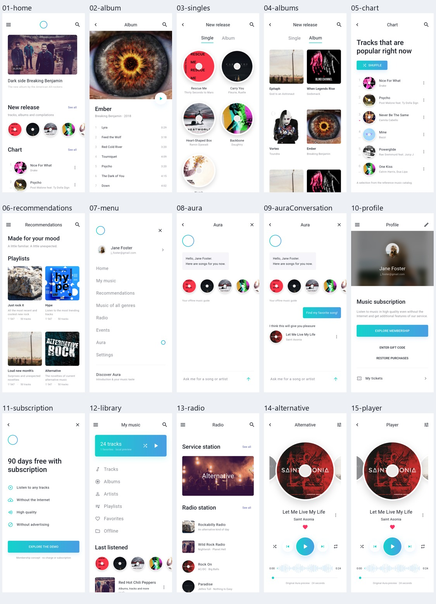
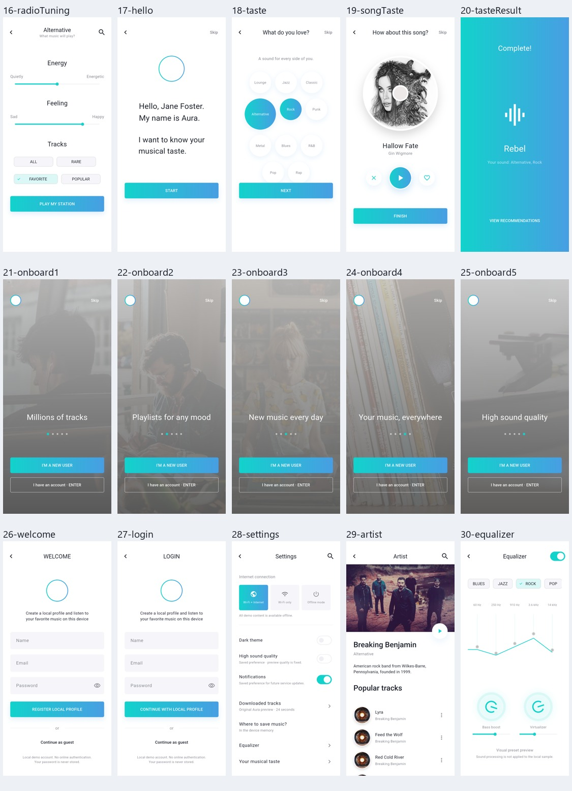
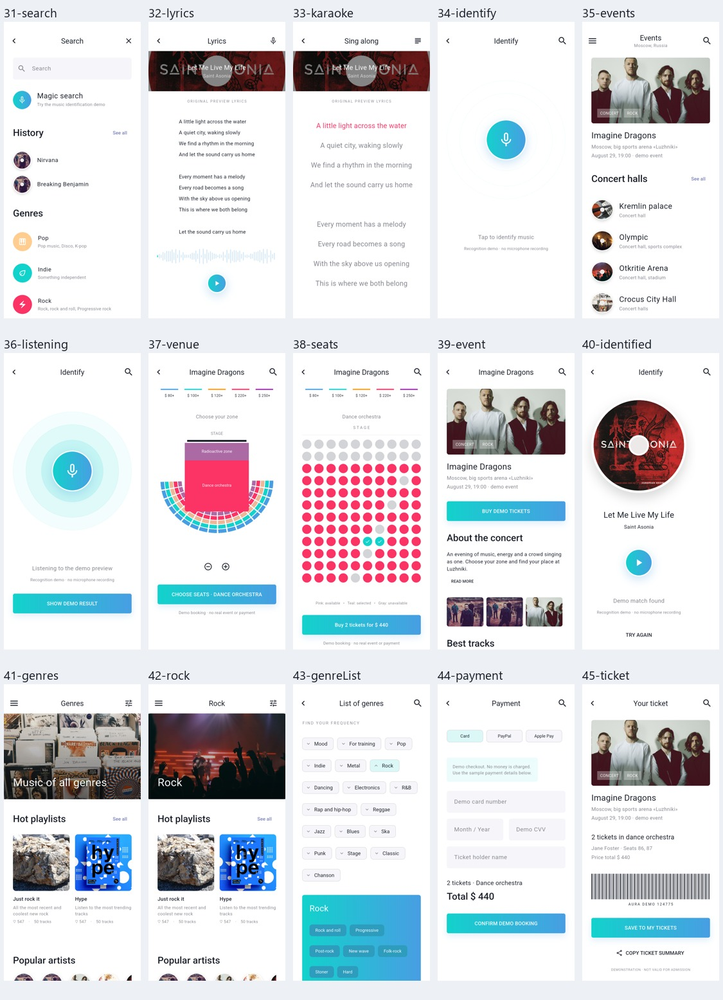

# 界面截图索引

所有 `screenshots/` 图片均由 Android 模拟器中的真实 Flutter 应用生成；`design-reference/` 为 Pixso 导出的原始设计图。截图覆盖各页面首屏，长页面可在应用内滚动查看。

## 主要流程



## 全部页面概览







## 45 个参考画板对应关系

| 序号 | 页面/状态 | 应用路由 | 实际截图 | Pixso 画板 | 原始参考图 |
| --- | --- | --- | --- | --- | --- |
| 01 | Home | `/home` | [查看](screenshots/01-home.png) | `0:126` · Home | [对照](design-reference/02-home.png) |
| 02 | Ember | `/album` | [查看](screenshots/02-album.png) | `0:5` · Album | [对照](design-reference/01-album.png) |
| 03 | New release | `/singles` | [查看](screenshots/03-singles.png) | `0:531` · new single | [对照](design-reference/03-new-single.png) |
| 04 | New release | `/albums` | [查看](screenshots/04-albums.png) | `0:636` · new album | [对照](design-reference/04-new-album.png) |
| 05 | Chart | `/chart` | [查看](screenshots/05-chart.png) | `0:705` · Chart | [对照](design-reference/05-chart.png) |
| 06 | Recommendations | `/recommendations` | [查看](screenshots/06-recommendations.png) | `0:899` · Recommendations | [对照](design-reference/06-recommendations.png) |
| 07 | Menu | `/menu` | [查看](screenshots/07-menu.png) | `0:1182` · Menu | [对照](design-reference/07-menu.png) |
| 08 | Aura | `/aura` | [查看](screenshots/08-aura.png) | `0:1241` · Aura1 | [对照](design-reference/08-aura1.png) |
| 09 | Aura | `/auraConversation` | [查看](screenshots/09-auraConversation.png) | `0:1345` · Aura2 | [对照](design-reference/09-aura2.png) |
| 10 | Profile | `/profile` | [查看](screenshots/10-profile.png) | `0:1474` · profile | [对照](design-reference/10-profile.png) |
| 11 | Membership | `/subscription` | [查看](screenshots/11-subscription.png) | `0:1526` · profile – 1 | [对照](design-reference/11-profile-1.png) |
| 12 | My music | `/library` | [查看](screenshots/12-library.png) | `0:1566` · My music | [对照](design-reference/12-my-music.png) |
| 13 | Radio | `/radio` | [查看](screenshots/13-radio.png) | `0:1706` · Radio | [对照](design-reference/13-radio.png) |
| 14 | Alternative | `/alternative` | [查看](screenshots/14-alternative.png) | `0:1782` · Alternative | [对照](design-reference/14-alternative.png) |
| 15 | Player | `/player` | [查看](screenshots/15-player.png) | `0:1889` · Player | [对照](design-reference/15-player.png) |
| 16 | Alternative | `/radioTuning` | [查看](screenshots/16-radioTuning.png) | `0:2009` · Alternative | [对照](design-reference/16-alternative.png) |
| 17 | Hello | `/hello` | [查看](screenshots/17-hello.png) | `0:2096` · Hello | [对照](design-reference/17-hello.png) |
| 18 | What do you love? | `/taste` | [查看](screenshots/18-taste.png) | `0:2136` · What do you love? | [对照](design-reference/18-what-do-you-love-.png) |
| 19 | How about this song? | `/songTaste` | [查看](screenshots/19-songTaste.png) | `0:2204` · What do you love? – 1 | [对照](design-reference/19-what-do-you-love-1.png) |
| 20 | Complete! | `/tasteResult` | [查看](screenshots/20-tasteResult.png) | `0:2285` · What do you love? – 2 | [对照](design-reference/20-what-do-you-love-2.png) |
| 21 | Millions of tracks | `/onboard1` | [查看](screenshots/21-onboard1.png) | `0:2325` · Onbord1 | [对照](design-reference/21-onbord1.png) |
| 22 | Playlists for any mood | `/onboard2` | [查看](screenshots/22-onboard2.png) | `0:2371` · Onbord2 | [对照](design-reference/22-onbord2.png) |
| 23 | New music every day | `/onboard3` | [查看](screenshots/23-onboard3.png) | `0:2417` · Onbord3 | [对照](design-reference/23-onbord3.png) |
| 24 | Your music, everywhere | `/onboard4` | [查看](screenshots/24-onboard4.png) | `0:2462` · Onbord4 | [对照](design-reference/24-onbord4.png) |
| 25 | High sound quality | `/onboard5` | [查看](screenshots/25-onboard5.png) | `0:2507` · Onbord5 | [对照](design-reference/25-onbord5.png) |
| 26 | Welcome | `/welcome` | [查看](screenshots/26-welcome.png) | `0:2552` · Welcome | [对照](design-reference/26-welcome.png) |
| 27 | Login | `/login` | [查看](screenshots/27-login.png) | `0:2621` · Login | [对照](design-reference/27-login.png) |
| 28 | Settings | `/settings` | [查看](screenshots/28-settings.png) | `0:2688` · Settings | [对照](design-reference/28-settings.png) |
| 29 | Breaking Benjamin | `/artist` | [查看](screenshots/29-artist.png) | `0:2759` · Artist | [对照](design-reference/29-artist.png) |
| 30 | Equalizer | `/equalizer` | [查看](screenshots/30-equalizer.png) | `0:2922` · Equalizer | [对照](design-reference/30-equalizer.png) |
| 31 | Search | `/search` | [查看](screenshots/31-search.png) | `0:3218` · Search | [对照](design-reference/31-search.png) |
| 32 | Lyrics | `/lyrics` | [查看](screenshots/32-lyrics.png) | `0:3301` · Lyrics-1 | [对照](design-reference/32-lyrics-1.png) |
| 33 | Sing along | `/karaoke` | [查看](screenshots/33-karaoke.png) | `0:3383` · Lyrics-2 – karaoke | [对照](design-reference/33-lyrics-2-karaoke.png) |
| 34 | Identify | `/identify` | [查看](screenshots/34-identify.png) | `0:3472` · Identify | [对照](design-reference/34-identify.png) |
| 35 | Events | `/events` | [查看](screenshots/35-events.png) | `0:3521` · Events | [对照](design-reference/35-events.png) |
| 36 | Identify | `/listening` | [查看](screenshots/36-listening.png) | `0:3660` · Identify – 1 | [对照](design-reference/36-identify-1.png) |
| 37 | Imagine Dragons | `/venue` | [查看](screenshots/37-venue.png) | `0:3709` · zone | [对照](design-reference/37-zone.png) |
| 38 | Imagine Dragons | `/seats` | [查看](screenshots/38-seats.png) | `0:3952` · zone – 1 | [对照](design-reference/38-zone-1.png) |
| 39 | Imagine Dragons | `/event` | [查看](screenshots/39-event.png) | `0:4197` · Imagine Dragons | [对照](design-reference/39-imagine-dragons.png) |
| 40 | Identify | `/identified` | [查看](screenshots/40-identified.png) | `0:4309` · Identify – 2 | [对照](design-reference/40-identify-2.png) |
| 41 | Music of all genres | `/genres` | [查看](screenshots/41-genres.png) | `0:4368` · Genres | [对照](design-reference/41-genres.png) |
| 42 | Rock | `/rock` | [查看](screenshots/42-rock.png) | `0:4550` · Rock | [对照](design-reference/42-rock.png) |
| 43 | List of genres | `/genreList` | [查看](screenshots/43-genreList.png) | `0:4755` · LIST OF GENRES | [对照](design-reference/43-list-of-genres.png) |
| 44 | Payment | `/payment` | [查看](screenshots/44-payment.png) | `0:4971` · Payment | [对照](design-reference/44-payment.png) |
| 45 | Your ticket | `/ticket` | [查看](screenshots/45-ticket.png) | `0:5037` · Your ticket | [对照](design-reference/45-your-ticket.png) |

## 补充交互状态

| 场景 | 截图 |
| --- | --- |
| 搜索匹配结果 | [查看](screenshots/46-search-results.png) |
| 搜索无结果 | [查看](screenshots/47-search-empty.png) |
| 输入持票人后确认三张票 | [查看](screenshots/48-ticket-booked.png) |
| 深色主题与迷你播放器 | [查看](screenshots/49-home-dark.png) |
| Release 安装包实际启动 | [查看](screenshots/release-launch.png) |

## 重新生成

```powershell
flutter drive -d emulator-5554 --driver test_driver/integration_test.dart --target integration_test/app_test.dart
```

截图使用隔离的测试内存数据。初始收藏为 Saint Asonia；初始选择两个演示座位。功能验证中再选择第三个座位，提交持票人并保存票据。
