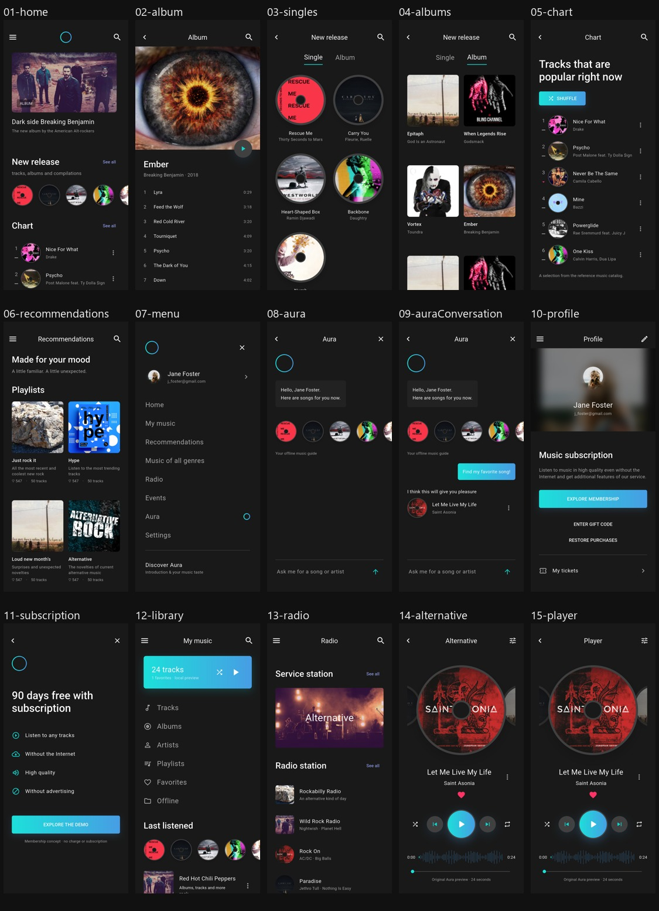
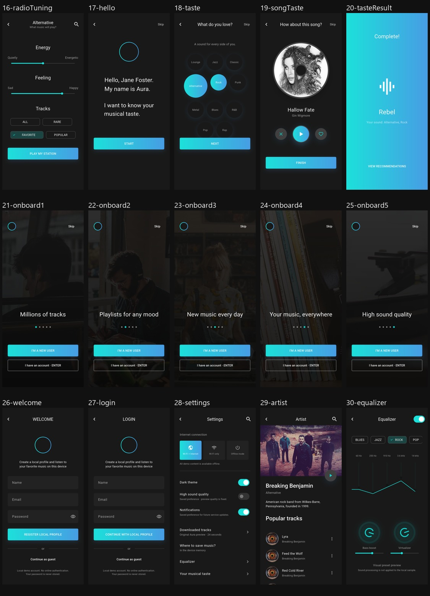
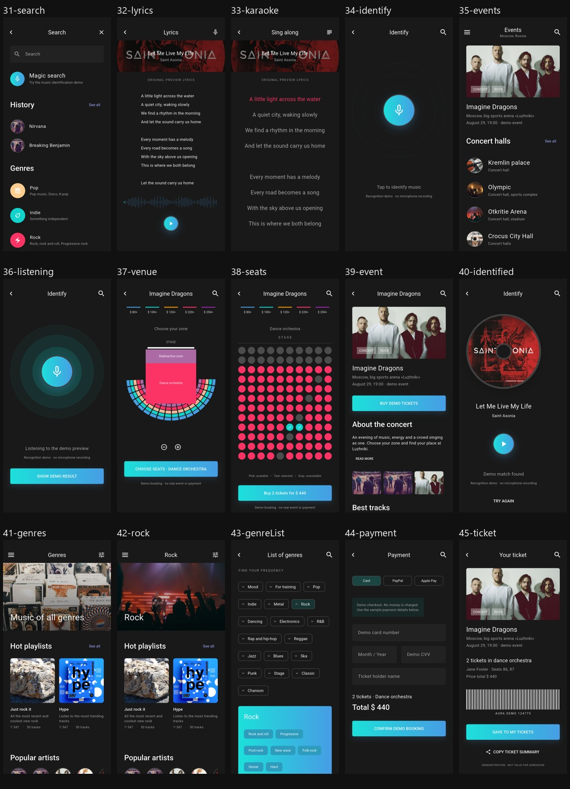

# 暗色界面截图索引

参考文件：Pixso **Music servis_dark**。截图由 Android 模拟器中的实际 Flutter 页面生成，45 个页面均与亮色版共用实现。

[暗色主题说明](DARK_THEME.md) · [亮色截图索引](SCREENSHOTS.md)


## 全部页面概览







## 画板对应关系

| 序号 | 页面/状态 | 路由 | 实际截图 | Pixso 节点 | 原始暗色参考 |
| --- | --- | --- | --- | --- | --- |
| 01 | Home | `/home` | [查看](screenshots/dark/01-home.png) | `0:5279` · Home – 1 | [对照](design-reference-dark/02-home-1.png) |
| 02 | Ember | `/album` | [查看](screenshots/dark/02-album.png) | `0:5158` · Album | [对照](design-reference-dark/01-album.png) |
| 03 | New release | `/singles` | [查看](screenshots/dark/03-singles.png) | `0:5684` · new single | [对照](design-reference-dark/03-new-single.png) |
| 04 | New release | `/albums` | [查看](screenshots/dark/04-albums.png) | `0:5789` · new album | [对照](design-reference-dark/04-new-album.png) |
| 05 | Chart | `/chart` | [查看](screenshots/dark/05-chart.png) | `0:5858` · Chart | [对照](design-reference-dark/05-chart.png) |
| 06 | Recommendations | `/recommendations` | [查看](screenshots/dark/06-recommendations.png) | `0:6052` · Recommendations | [对照](design-reference-dark/06-recommendations.png) |
| 07 | Menu | `/menu` | [查看](screenshots/dark/07-menu.png) | `0:6335` · Menu | [对照](design-reference-dark/07-menu.png) |
| 08 | Aura | `/aura` | [查看](screenshots/dark/08-aura.png) | `0:6393` · Aura1 | [对照](design-reference-dark/08-aura1.png) |
| 09 | Aura | `/auraConversation` | [查看](screenshots/dark/09-auraConversation.png) | `0:6497` · Aura2 | [对照](design-reference-dark/09-aura2.png) |
| 10 | Profile | `/profile` | [查看](screenshots/dark/10-profile.png) | `0:6626` · profile | [对照](design-reference-dark/10-profile.png) |
| 11 | Membership | `/subscription` | [查看](screenshots/dark/11-subscription.png) | `0:6678` · profile – 1 | [对照](design-reference-dark/11-profile-1.png) |
| 12 | My music | `/library` | [查看](screenshots/dark/12-library.png) | `0:6744` · My music | [对照](design-reference-dark/12-my-music.png) |
| 13 | Radio | `/radio` | [查看](screenshots/dark/13-radio.png) | `0:6884` · Radio | [对照](design-reference-dark/13-radio.png) |
| 14 | Alternative | `/alternative` | [查看](screenshots/dark/14-alternative.png) | `0:6960` · Alternative | [对照](design-reference-dark/14-alternative.png) |
| 15 | Player | `/player` | [查看](screenshots/dark/15-player.png) | `0:7067` · Player | [对照](design-reference-dark/15-player.png) |
| 16 | Alternative | `/radioTuning` | [查看](screenshots/dark/16-radioTuning.png) | `0:7188` · Alternative | [对照](design-reference-dark/16-alternative.png) |
| 17 | Hello | `/hello` | [查看](screenshots/dark/17-hello.png) | `0:7275` · Hello | [对照](design-reference-dark/17-hello.png) |
| 18 | What do you love? | `/taste` | [查看](screenshots/dark/18-taste.png) | `0:7315` · What do you love? | [对照](design-reference-dark/18-what-do-you-love-.png) |
| 19 | How about this song? | `/songTaste` | [查看](screenshots/dark/19-songTaste.png) | `0:7383` · What do you love? – 1 | [对照](design-reference-dark/19-what-do-you-love-1.png) |
| 20 | Complete! | `/tasteResult` | [查看](screenshots/dark/20-tasteResult.png) | `0:7464` · What do you love? – 2 | [对照](design-reference-dark/20-what-do-you-love-2.png) |
| 21 | Millions of tracks | `/onboard1` | [查看](screenshots/dark/21-onboard1.png) | `0:7504` · Onbord1 | [对照](design-reference-dark/21-onbord1.png) |
| 22 | Playlists for any mood | `/onboard2` | [查看](screenshots/dark/22-onboard2.png) | `0:7550` · Onbord2 | [对照](design-reference-dark/22-onbord2.png) |
| 23 | New music every day | `/onboard3` | [查看](screenshots/dark/23-onboard3.png) | `0:7596` · Onbord3 | [对照](design-reference-dark/23-onbord3.png) |
| 24 | Your music, everywhere | `/onboard4` | [查看](screenshots/dark/24-onboard4.png) | `0:7641` · Onbord4 | [对照](design-reference-dark/24-onbord4.png) |
| 25 | High sound quality | `/onboard5` | [查看](screenshots/dark/25-onboard5.png) | `0:7755` · Onbord5 | [对照](design-reference-dark/26-onbord5.png) |
| 26 | Welcome | `/welcome` | [查看](screenshots/dark/26-welcome.png) | `0:7686` · Welcome | [对照](design-reference-dark/25-welcome.png) |
| 27 | Login | `/login` | [查看](screenshots/dark/27-login.png) | `0:7800` · Login | [对照](design-reference-dark/27-login.png) |
| 28 | Settings | `/settings` | [查看](screenshots/dark/28-settings.png) | `0:7867` · Settings | [对照](design-reference-dark/28-settings.png) |
| 29 | Breaking Benjamin | `/artist` | [查看](screenshots/dark/29-artist.png) | `0:7938` · Artist | [对照](design-reference-dark/29-artist.png) |
| 30 | Equalizer | `/equalizer` | [查看](screenshots/dark/30-equalizer.png) | `0:8100` · Equalizer | [对照](design-reference-dark/30-equalizer.png) |
| 31 | Search | `/search` | [查看](screenshots/dark/31-search.png) | `0:8396` · Search | [对照](design-reference-dark/31-search.png) |
| 32 | Lyrics | `/lyrics` | [查看](screenshots/dark/32-lyrics.png) | `0:8479` · Lyrics-1 | [对照](design-reference-dark/32-lyrics-1.png) |
| 33 | Sing along | `/karaoke` | [查看](screenshots/dark/33-karaoke.png) | `0:8584` · Lyrics-2 – karaoke | [对照](design-reference-dark/33-lyrics-2-karaoke.png) |
| 34 | Identify | `/identify` | [查看](screenshots/dark/34-identify.png) | `0:8696` · Identify | [对照](design-reference-dark/34-identify.png) |
| 35 | Events | `/events` | [查看](screenshots/dark/35-events.png) | `0:8745` · Events | [对照](design-reference-dark/35-events.png) |
| 36 | Identify | `/listening` | [查看](screenshots/dark/36-listening.png) | `0:8883` · Identify – 1 | [对照](design-reference-dark/36-identify-1.png) |
| 37 | Imagine Dragons | `/venue` | [查看](screenshots/dark/37-venue.png) | `0:8932` · zone | [对照](design-reference-dark/37-zone.png) |
| 38 | Imagine Dragons | `/seats` | [查看](screenshots/dark/38-seats.png) | `0:9175` · zone – 1 | [对照](design-reference-dark/38-zone-1.png) |
| 39 | Imagine Dragons | `/event` | [查看](screenshots/dark/39-event.png) | `0:9420` · Imagine Dragons | [对照](design-reference-dark/39-imagine-dragons.png) |
| 40 | Identify | `/identified` | [查看](screenshots/dark/40-identified.png) | `0:9532` · Identify – 2 | [对照](design-reference-dark/40-identify-2.png) |
| 41 | Music of all genres | `/genres` | [查看](screenshots/dark/41-genres.png) | `0:9591` · Genres | [对照](design-reference-dark/41-genres.png) |
| 42 | Rock | `/rock` | [查看](screenshots/dark/42-rock.png) | `0:9773` · Rock | [对照](design-reference-dark/42-rock.png) |
| 43 | List of genres | `/genreList` | [查看](screenshots/dark/43-genreList.png) | `0:9978` · LIST OF GENRES | [对照](design-reference-dark/43-list-of-genres.png) |
| 44 | Payment | `/payment` | [查看](screenshots/dark/44-payment.png) | `0:10194` · Payment | [对照](design-reference-dark/44-payment.png) |
| 45 | Your ticket | `/ticket` | [查看](screenshots/dark/45-ticket.png) | `0:10260` · Your ticket | [对照](design-reference-dark/45-your-ticket.png) |

## 补充状态

| 状态 | 截图 |
| --- | --- |
| 暗色搜索结果 | [查看](screenshots/dark/46-search-results.png) |
| 暗色搜索空状态 | [查看](screenshots/dark/47-search-empty.png) |
| 暗色购票确认 | [查看](screenshots/dark/48-ticket-booked.png) |
| 从暗色切换为亮色，保留迷你播放器 | [查看](screenshots/dark/49-home-light.png) |
| Release 安装包默认暗色启动 | [查看](screenshots/dark/release-launch.png) |

## 重新生成两套截图

```powershell
flutter drive --no-dds -d emulator-5554 --driver test_driver/integration_test.dart --target integration_test/app_test.dart
```

亮色输出到 `docs/screenshots/`，暗色输出到 `docs/screenshots/dark/`。测试使用隔离的内存资料。
