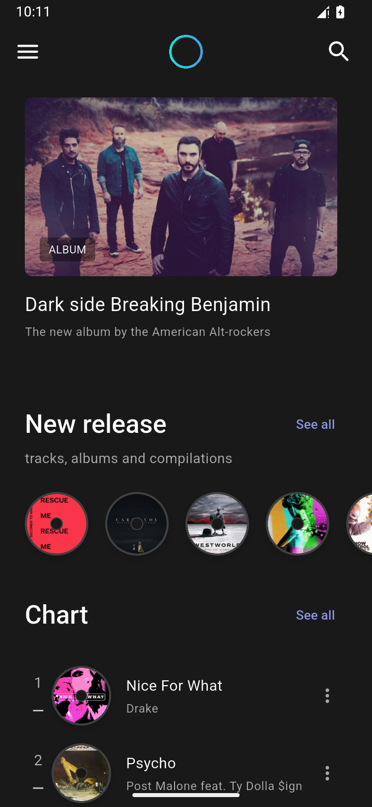

# 验证记录

验证日期：2026-10-24。

## 环境

| 项目 | 环境 |
| --- | --- |
| Flutter / Dart | 3.47.7 stable / 3.13.5 |
| 构建系统 | Windows 11，Java 21 |
| Android 模拟器 | Android 15 / API 35，750×1624 物理像素，375 逻辑宽度 |
| 本机测试设备 | `aura_music_review`，独立创建，未使用其他项目模拟器的数据 |

## 最终结果

| 检查 | 结果 |
| --- | --- |
| 静态分析 | 通过，No issues found |
| 单元与 Widget 测试 | 9 项通过 |
| 页面布局 | 45 个页面 × 375/600 两种宽度 × 明暗主题，180 次渲染通过 |
| Android 集成测试 | 两套主题通过，使用真实素材和真实音频插件 |
| Android Release | 构建成功，已实际安装并启动 |
| Web Release | 构建成功，Wasm dry run 成功；未进行浏览器交互回归 |
| 文档资源链接 | 相对图片和文件链接检查通过 |

## Android 集成用例

- 使用真实 Flutter 引擎分别遍历两种主题的全部 45 个页面，检查运行异常并生成截图。
- 图片预加载完成后截图，避免首帧尚未解码的空白图片。
- 搜索 `Rescue`，验证匹配歌曲；搜索无匹配内容，验证空状态。
- 实际播放原创 WAV，等待真实播放位置大于零，再验证拖动进度与暂停。
- 在已有两个演示座位的基础上再选一个，进入模拟支付，填写持票人姓名，生成三张票的确认记录。
- 保存票据，验证本地状态；分别切换至相反主题并截图。
- Widget 测试补充验证新安装默认暗色、已保存亮色选择的恢复、背景/表面/唱片颜色，以及切换主题时路由与播放状态保留。

生成 98 张编号界面截图，每套主题各 45 个页面和 4 个补充状态。原图见 [亮色截图索引](SCREENSHOTS.md) 和 [暗色截图索引](SCREENSHOTS_DARK.md)。另保存更新后的 Release 安装包默认暗色启动截图：

## 测试范围与已知限制

Windows 上的 Flutter 3.47.7 `flutter_tester.exe` 在批量渲染图片资源期间出现过原生 `0xc0000005` 崩溃。Widget 测试使用一像素图片替身，并在测试资源清单中共享同一个图片键，减少宿主机并行解码；最终 9 项测试通过。真实图片没有替换进入应用，全部 37 个正式素材通过 Android 页面运行与截图验证。

Android 是本次完整验证的平台。Web 已验证编译；Windows 桌面构建和运行未验证。没有进行在线账户、真实订阅、支付、识曲或音频均衡处理测试，因为当前交付中这些属于明确标识的本地演示。

预览安装包位于 [dist/aura-music-demo.apk](../dist/aura-music-demo.apk)。它是通用架构 Release 包，使用开发签名，供本地安装验证。
